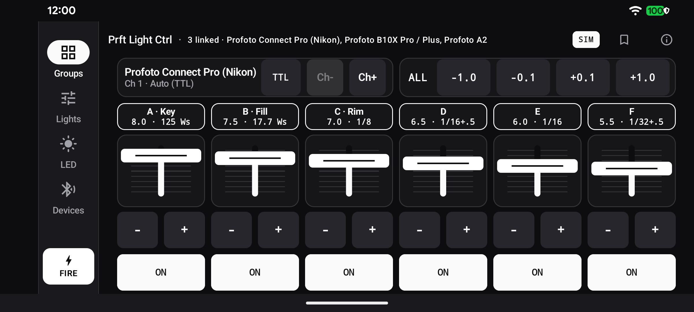
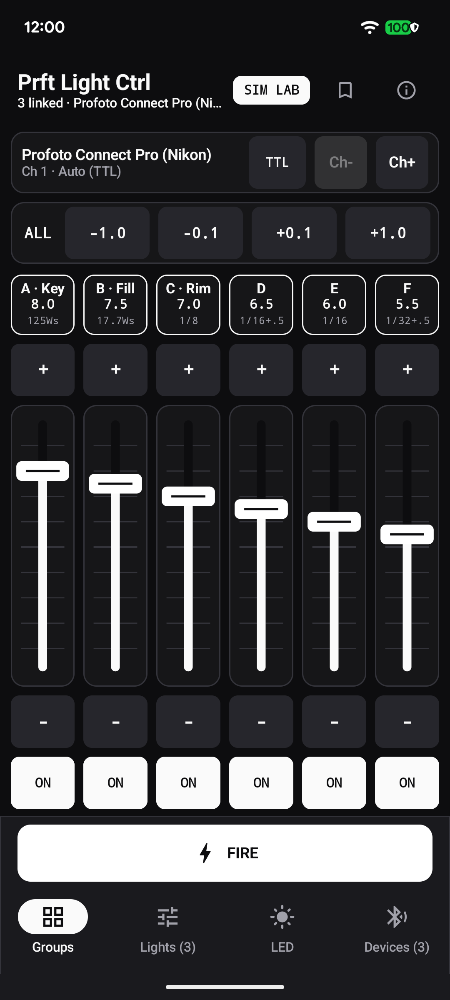
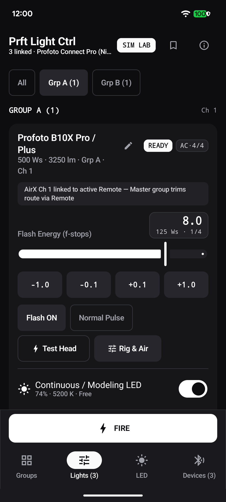
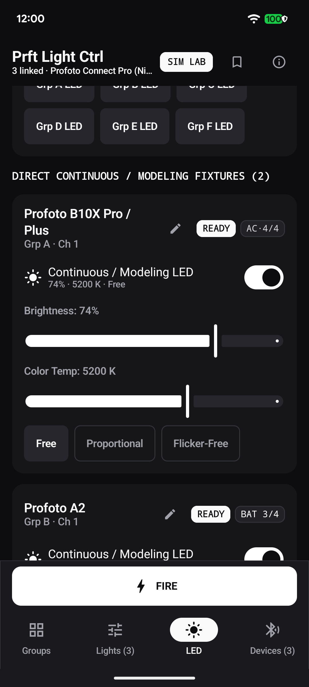
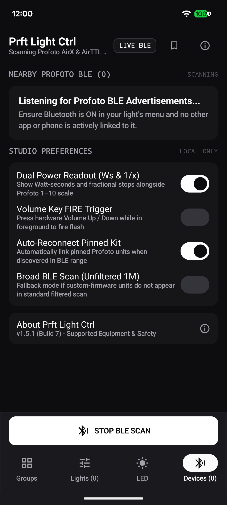
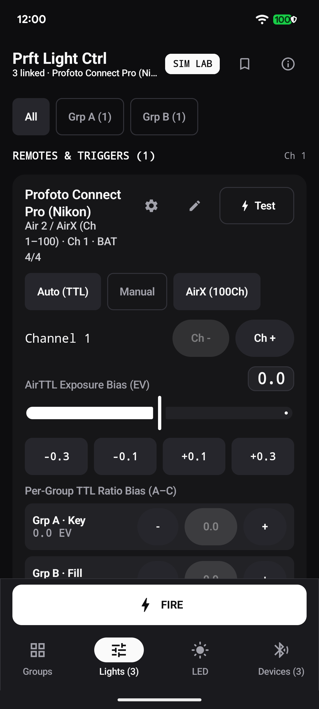
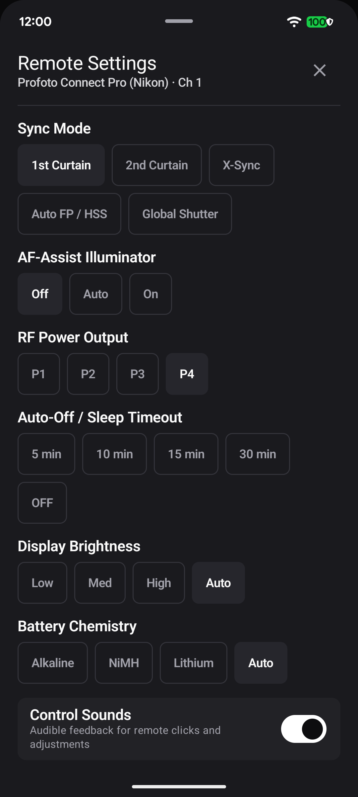
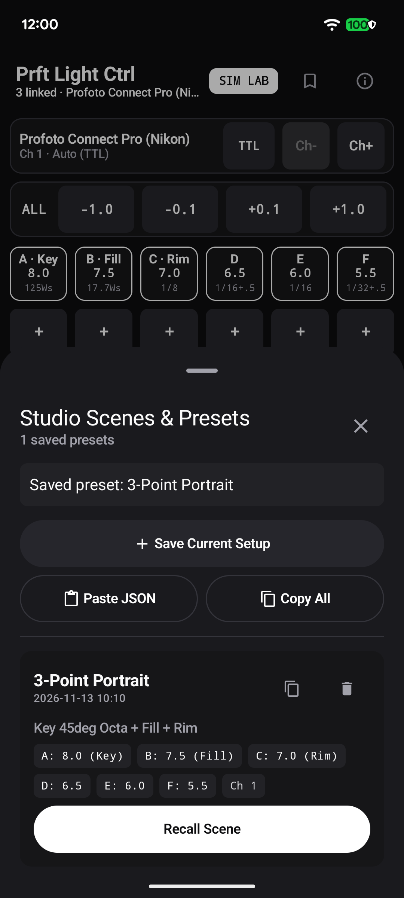

# Prft Light Ctrl (`app.prft.lightctrl`)

Privacy-first, 100% offline native Android Bluetooth Low Energy (BLE) studio lighting controller for **Profoto AirX & AirTTL** strobes and remotes. Built in Kotlin and Jetpack Compose for **modern Android (`Android 12–16+`, `API 31+`) phones and tablets** — zero accounts, zero internet access, zero location tracking, and zero bloat.

## Why Prft Light Ctrl? (Pain Points Solved)

- **No Account or Cloud Login Wall:** Opens straight to your studio console. Never get locked out of your lights on location or in a basement studio without cell service because an app update signed you out of a cloud account.
- **100% Offline & Zero Tracking:** Requests **`0` `INTERNET` permission** (physically incapable of telemetry, analytics, or network calls) and uses Android 12+ `neverForLocation` hardware-filtered BLE scanning so GPS / Location permission is **never** requested.
- **Fast, Reliable Android BLE Reconnects:** Pinned-kit auto-reconnect, foreground `connectedDevice` keepalive (locking your phone does not drop GATT sync), and hardware-filtered `1M` scanning across modern Android phones (Pixel, Samsung One UI, Xiaomi, OnePlus, Sony, Motorola).
- **Built for Real Studio Workflows:**
  - **Saved Studio Scenes & Offline JSON Share:** Save named multi-light ratios + modifier notes and recall in one tap, or copy/paste scenes as offline JSON (missing from the official mobile app).
  - **Named Group Roles (`Key`, `Fill`, `Rim`, etc.):** Label groups directly on the `A–F` faders alongside custom fixture nicknames.
  - **Dual Power Readout (`Ws` & `1/1..1/512` Fractions):** Optional Watt-second and fractional stop display alongside Profoto's `1–10` scale so mixing `100 Ws`, `250 Ws`, and `500 Ws` heads stays intuitive.
  - **Portrait One-Hand + Landscape / Tablet Console:** Full 6-channel `A–F` fader bank (`0.1–10.0` stop range) with thumb-zone `FIRE` button, optional **Volume Key `FIRE` trigger** for eyes-free light-meter walks, and native Landscape `NavigationRail`.
  - **Complete Remote & Strobe Controls:** `Connect Pro` software `Auto (TTL)` / `Manual` switch, Per-Group `A–C` TTL ratio biases, Remote Hardware Settings (`1st/2nd Curtain`, `X-Sync`, `HSS`, `Global Shutter`, `AF-Assist`, `RF Power P1–P4`, `1–100` fast channel picker), and live strobe power fusion even when paired with a buttonless `Profoto Connect`.

## Screenshots

### Landscape & Tablet 6-Fader Console

<p align="center">
  
</p>

### 4-Tab Studio Workflow (`Groups` · `Lights` · `LED` · `Devices`)

| Groups (`A–F` Fader Bank) | Lights (Monolight Deck) | LED (Bi-Color & Modeling) | Devices & Preferences |
| :---: | :---: | :---: | :---: |
|  |  |  |  |

### AirX / AirTTL Remotes & Saved Studio Scenes

| `Connect Pro` (`Auto TTL` / `Manual`) | Remote Hardware Settings | Studio Scenes & Presets |
| :---: | :---: | :---: |
|  |  |  |

## Hardware Compatibility

### 1. Physically Verified (Direct Bluetooth / BLE)
- **Profoto B10X Plus / Pro, B10X, B10 Plus & B10** (`ID 140–144` — `250 Ws` / `500 Ws` flash, `3000–6500 K` bi-color continuous LED, Freeze/Normal, Ready signals)
- **Profoto A2** (`ID 36` — `100 Ws` flash + LED modeling light)
- **Profoto Connect Pro** (`ID 161–166`, all camera mounts — 100-channel Air 2 / AirX 6-group `A–F` remote, software `Auto TTL` / `Manual` switch, Per-Group `A–C` TTL ratios, Sync/HSS/Global Shutter, AF-Assist & RF Power)
- **Profoto Connect** (`ID 150–154`, all camera mounts — AirTTL / Manual / Off remote, studio group standby, Air modeling toggle & TTL EV trim)

### 2. Protocol-Compatible Direct BLE (Catalog-Mapped, Untested on Physical Units)
- **AirX Strobes & Packs (`A10`, `B20`, `B30`, `D30`, `Pro-D3 750/1250`, `Pro-B3`, `Pro-11`, `C1` / `C1 Plus`):** Mapped in `HardwareCatalog` using standard Profoto PUP flash, group, channel, modeling, and test-fire opcodes (pack-specific AC charge-rate menus and `11.0` stop ceiling are not exposed).

### 3. Indirect Radio Control via `Connect Pro` or `Connect` (Older Non-Bluetooth Air Strobes)
- **Pre-Bluetooth Air / AirTTL Strobes (`B1`, `B1X`, `B2`, `D1`, non-AirX `D2`, `Pro-10`):** These older strobes have no Bluetooth chip inside the head, so no phone app can connect to them directly. Connect a **`Connect Pro`** or **`Connect`** remote to `Prft Light Ctrl` over Bluetooth on the matching Air channel (`Ch 1–8` / `1–20`) to control their groups and test-fire over `2.4 GHz` Air radio.

### 4. Not Supported
- **Cinema RGBWW / DMX Fixtures (`L600C`, `L600D`, `L600X`, `L1600D`, `ProPanel 3x2`):** Dedicated HSI / RGBW / Gel / SFX / CRMX / Fan controls are not implemented.
- **Pre-Bluetooth `Air Remote TTL` (LCD triggers prior to `Connect`):** `2.4 GHz` radio only, no Bluetooth hardware.

## Known Limitations

- **Lighting Controller Only (No Smartphone Camera Sync):** Controls flash energy, TTL ratios, continuous/modeling LEDs, and test-fires strobes (`FIRE`), but does **not** capture photos or sync smartphone camera frames with flash.
- **No Firmware Updates:** Because the app is 100% offline (`0` `INTERNET` permission) and isolates DFU/bootloader GATT characteristics to prevent mid-shoot bricking, it cannot check for or install device firmware updates. Use Profoto's official desktop USB updater (for USB-C units like `B10/B10X`, `A2`, `Connect`) or temporarily use the official `Profoto Control` app (required for portless remotes like `Connect Pro`) when a firmware update is needed.
- **Exclusive BLE Link Per Fixture:** Profoto lights and remotes accept one active BLE GATT client at a time. Force-close the official `Profoto Control` app (or disconnect any second phone) before scanning, and connect inside **`Prft Light Ctrl -> Devices`** rather than Android's system Bluetooth pairing menu.
- **Buttonless `Profoto Connect` Hardware Ring:** On non-Pro `Connect`, `Off / Auto / Manual` is controlled by the physical rotation ring and cannot be switched in software; without individual strobes also linked over BLE, non-Pro `Connect` sends relative power shifts rather than displaying per-group absolute readouts.
- **Android 11 and Older Not Supported:** Supports modern **Android 12 through Android 16+** (`API 31+`). Android 11 and older (`API <= 30`) lack location-free (`neverForLocation`) BLE permissions.

## Install & Auto-Updates

### Option 1 — F-Droid / Droid-ify / Neo Store (Recommended Auto-Updates)

1. Install [**Official F-Droid (`f-droid.org`)**](https://f-droid.org/) (direct APK: [`F-Droid.apk`](https://f-droid.org/F-Droid.apk)), [**Droid-ify**](https://github.com/Droid-ify/client/releases/latest), or [**Neo Store**](https://github.com/NeoApplications/Neo-Store/releases/latest).
2. In F-Droid, open **Settings &rarr; Repositories &rarr; +** and **scan this QR code** using F-Droid's **Scan QR** button:

   <a href="https://github.com/nomid-ws/fdroid#setup-instructions">
      Repositories -> + -> Scan QR) to add NoMid Repository" />
   </a>

   *Or copy & paste this pinned Repository URL into **Settings &rarr; Repositories &rarr; +** (F-Droid auto-fills the URL and signing key from your clipboard):*
   ```text
   https://raw.githubusercontent.com/nomid-ws/fdroid/main/repo?fingerprint=5B8E20619C48FD8F04A0174B4AE00D2C6AE24834B85EA77F57C5456AC9802532
   ```
3. Pull down to refresh repositories in F-Droid, search **Prft Light Ctrl**, and tap **Install**.

### Option 2 — Obtainium

- [**Add to Obtainium**](https://apps.obtainium.imranr.dev/redirect?r=obtainium://add/https://github.com/nomid-ws/Prft_Lght_Ctrl) — or paste `https://github.com/nomid-ws/Prft_Lght_Ctrl` into [Obtainium](https://github.com/ImranR98/Obtainium/releases/latest) to track signed GitHub Releases directly.

### Option 3 — Direct APK Sideload

- [**Download `Prft_Lght_Ctrl-v1.5.1-release.apk` from GitHub Releases**](https://github.com/nomid-ws/Prft_Lght_Ctrl/releases/latest) — reproducible APK signed with `CN=NoMid` (`16cd3fd6bf68205b6b50e710c5d757f9ffe65bebc038d2bca1bbf21f32caef38`).

## Protocol Specification

- [**Profoto BLE & PUP Wire Protocol Specification (`docs/PROFOTO_BLE_PROTOCOL_SPEC.md`)**](docs/PROFOTO_BLE_PROTOCOL_SPEC.md) — Cleanroom byte-level specification covering GATT services (`0xFDBB` / `1d944db4-...`), client authentication handshake, rolling `counter % 240` + `uint16_le` packet framing, `AllSettingsV2` TLV state synchronization, and complete PUP control/telemetry opcodes.

## Project Structure

- `:core:protocol` — Pure JVM PUP wire frame codec (`counter % 240` + `uint16_le` framing, `AllSettingsV2` TLV parser, hardware catalog).
- `:core:ble` — Android `BluetoothGatt` 10-stage connection state machine & foreground `connectedDevice` service.
- `:core:domain` — Multi-light `StudioOrchestrator`, shared AirX channel collision guard, and 6-group `A–F` fader state engine.
- `:app` — Responsive Jetpack Compose UI for Portrait phones and Landscape / Tablet postures.
- `docs/PROFOTO_BLE_PROTOCOL_SPEC.md` — BLE GATT & PUP binary wire protocol reference.

## Build & Test

```bash
./gradlew :core:protocol:test :core:ble:testDebugUnitTest :core:domain:testDebugUnitTest
./gradlew :app:assembleRelease
```

## License & Disclaimer

Licensed under the **GNU General Public License v3.0 or later (`GPL-3.0-or-later`)** — see [`LICENSE`](LICENSE).

*Prft Light Ctrl is an independent, cleanroom interoperability project and is not affiliated with, endorsed by, or sponsored by Profoto AB. All product names are trademarks of their respective owners.*
